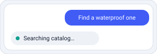
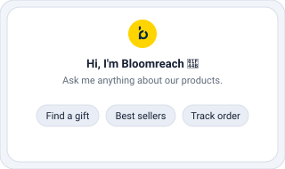

[← Back to How the chat integration works](01-how-the-chat-integration-works.md)

# 2. Basic event types (messages)

The everyday building blocks: the shopper's text, the assistant's text and its streaming chunks, the in-place progress indicator, and the welcome message.

## User text message <sup>`Outbound`</sup> (echoed)

`ADD_MESSAGE.USER.TEXT`


### The shopper types a message

```ts
{ _id: string,
  type: "ADD_MESSAGE.USER.TEXT",
  sentDate: string,              // ISO date-time
  text: string }
```

Right-aligned bubble. The server echoes this same event back on the turn — if you render optimistically, de-duplicate the echoed copy by `_id`.

Quick-reply selections do **not** use this event — they are always sent as `ADD_MESSAGE.USER.DIRECT_CALL` (see [Quick replies](03-rich-messages.md#quick-replies-inbound)), even when the option has no `target`/`payload`.

## Assistant text message <sup>`Inbound`</sup>

`ADD_MESSAGE.ASSISTANT.TEXT`


### A complete (or starting) assistant message

```ts
{ _id: string,
  type: "ADD_MESSAGE.ASSISTANT.TEXT",
  sentDate: string,              // ISO date-time
  text: string,
  marker?: string,
  skipToneOfVoice?: boolean,
  product_id_link_mapping?: string[],
  batchId?: string }             // one reply, many events
```

Render as GitHub Flavored Markdown (links, tables, lists). It may be the seed that later `APPEND` chunks fold into. `product_id_link_mapping` helps rewrite inline product links to PDP URLs.

## Streaming chunk <sup>`Inbound`</sup>

`APPEND_LAST_ASSISTANT_MESSAGE`


### Fold into the previous assistant bubble

```ts
{ _id: string,
  type: "APPEND_LAST_ASSISTANT_MESSAGE",
  sentDate: string,              // ISO date-time
  text: string }
```

Append `text` to the most recent `ASSISTANT.TEXT` bubble. If an `APPEND` arrives with no prior text message, start a new one from it.

```js
case 'APPEND_LAST_ASSISTANT_MESSAGE':
  if (lastAssistantMsg) { lastAssistantMsg.text += event.text; update() }
  else { lastAssistantMsg = {...event, type: 'ADD_MESSAGE.ASSISTANT.TEXT'}; append() }
```

## Progress notification <sup>`Inbound`</sup>

`ADD_MESSAGE.ASSISTANT.NOTIFICATION`



### In-place progress update

```ts
{ _id: string,
  type: "ADD_MESSAGE.ASSISTANT.NOTIFICATION",
  sentDate: string,              // ISO date-time
  toolName: string,              // internal — DO NOT display
  text: string }                 // what the user sees
```

- **Show only `text`** — `toolName` is internal.
- **Replace, don't append** — one in-place element, not a bubble per notification.
- **Clear when the turn completes** — keep it visible while messages stream in; remove it only after the request finishes and all response events have been received.
- **Initial state** — show `notificationThinking` the moment the user submits; the first notification overwrites it.

## Welcome / cold start <sup>`Both`</sup>

`ADD_MESSAGE.ASSISTANT.COLD_START`



### The blank-slate welcome screen

```ts
{ _id: string,
  type: "ADD_MESSAGE.ASSISTANT.COLD_START",
  sentDate: string,              // ISO date-time
  text: string,
  engText?: string,
  areCartProducts?: boolean,
  productIdsToShow?: string[],
  initialContext?: object,       // recorded with the greeting only; send context with FE.SET_CONTEXT
  quickReply?: { label: string; target?: string; payload?: object }[] }
```

Asks for the greeting of a chat the shopper has not written in yet. Send it when the [sync](04-advanced-cases.md#history-restoration-outbound) of a new `chatId` returns nothing, with the welcome `text` (`translated.welcomeMessage` from `general-settings`). `initialContext` is only recorded with the greeting: the agent gets the shopper's context from [`FE.SET_CONTEXT`](04-advanced-cases.md#set-context-both), sent right before the first message. The server echoes it and streams the greeting as `ADD_MESSAGE.ASSISTANT.TEXT`, plus quick replies or products depending on the agent. Render that greeting — the echoed cold start is a marker, not a bubble, and replayed transcripts carry both.

A greeting nobody answers creates no conversation. The server keeps it for 24 hours: a sync of the chat in that time replays it, and the shopper's first message stores it in front of the conversation. Send the cold starts on screen as `openingInputs` in the body of that first message (`send-event`'s optional `openingInputs` field): if the kept greeting has expired, the newest one is run again and stored. Never resend the cold start to restore a greeting — sync instead.

---

[← Chapter 1 — How the chat integration works](01-how-the-chat-integration-works.md) · [Chapter 3 — Rich messages →](03-rich-messages.md)
